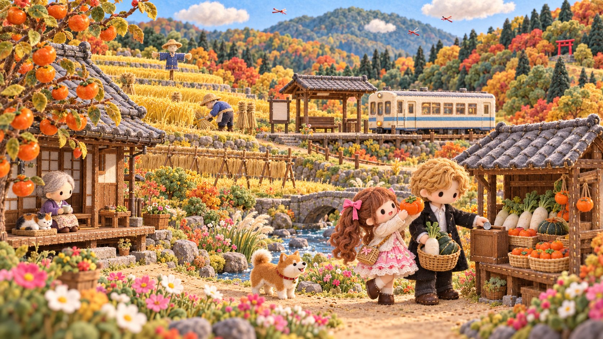
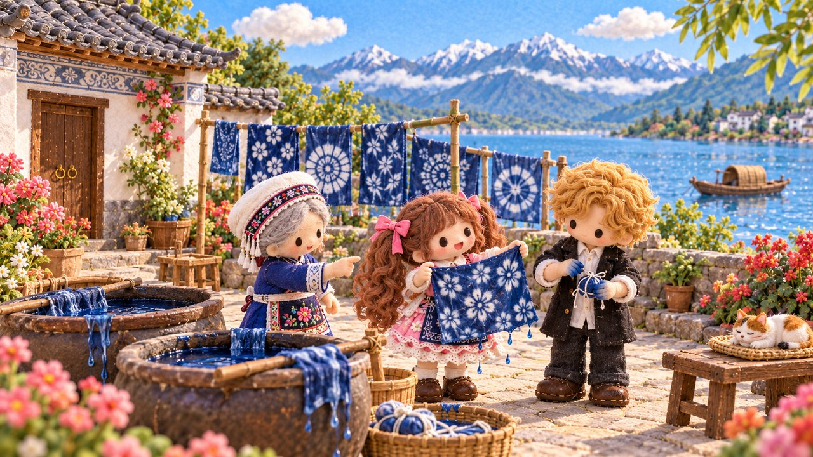
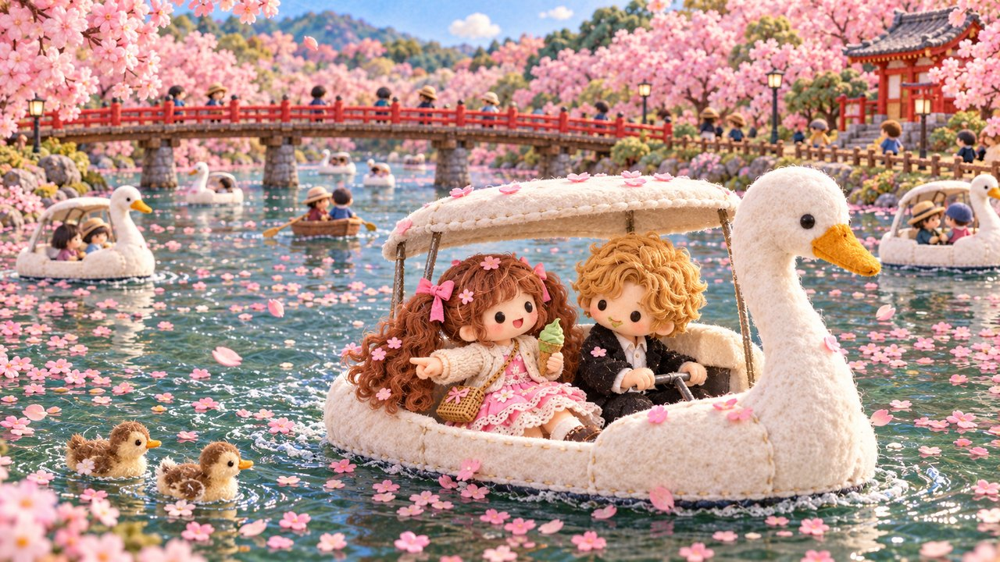
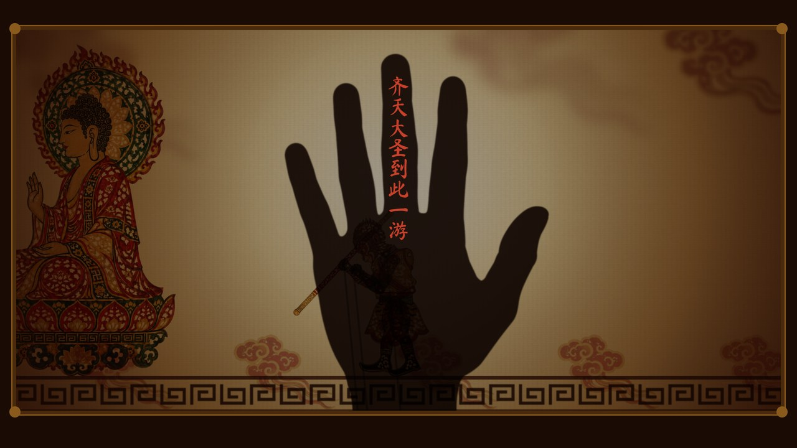
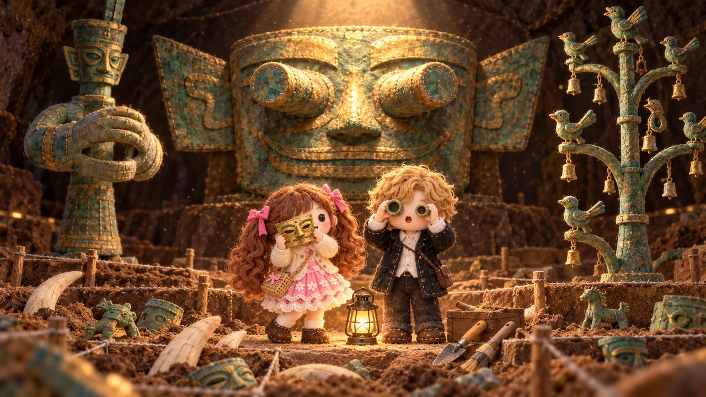
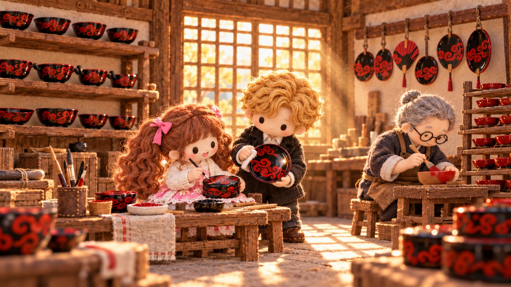

  

### Hi, I'm Nicole 👋

🎮 AI-native game producer · 12 years making games\
🌍 Slow traveler. Wherever I land, my AI crew and I turn the local culture into games and stories.

**旅をしながら、その土地の文化をAIの仲間と一緒にゲームや物語にしています。**\
いま夢中なこと：日本の地方に旅人を呼ぶゲームと物語。

#### 🗺️ Places I'm turning into games

<table>
  <tr>
    <td width="50%"></td>
    <td width="50%"></td>
  </tr>
  <tr>
    <td>🧵 <b>Dali, Yunnan</b> — a Bai village by the lake: tie-dye, markets, courtyards</td>
    <td>🦢 <b>Kichijoji, Tokyo</b> — swan boats on the big park pond, alleys by the station, a covered shopping street</td>
  </tr>
</table>

- 🗾 **Rural Japan** — games and stories that bring travelers to the countryside (that's the header ↑)
- 🧶 **A cozy felt-craft life sim** (in development) — Dali and Kichijoji above are two of its maps
- 🎀 **Harajuku street fashion** — a street built around the girls' street-fashion culture of Harajuku, still in the works

#### 🏺 Old crafts, new games

<table>
  <tr>
    <td width="33%"></td>
    <td width="33%"></td>
    <td width="33%"></td>
  </tr>
  <tr>
    <td>🎭 <b>Wei Ru Liu（未入流）</b> — a playable shadow-puppet <i>Journey to the West</i>. Every line is quoted from the original novel; only the order of the scenes is new. Five acts, nineteen scenes, playable start to finish</td>
    <td>👁️ <b>Sanxingdui bronzes（三星堆）</b> — the giant masks and bronze trees of ancient Shu, next on my list</td>
    <td>🖌️ <b>Lacquerware（漆器）</b> — red and black, layer by layer, next on my list</td>
  </tr>
</table>

🛠️ Claude Code · Codex · and whatever AI fits the job\
📫 [LinkedIn](https://www.linkedin.com/in/nicole-huo-68727444/)

The felt pictures are concept art. The shadow-puppet picture is from the game itself.
